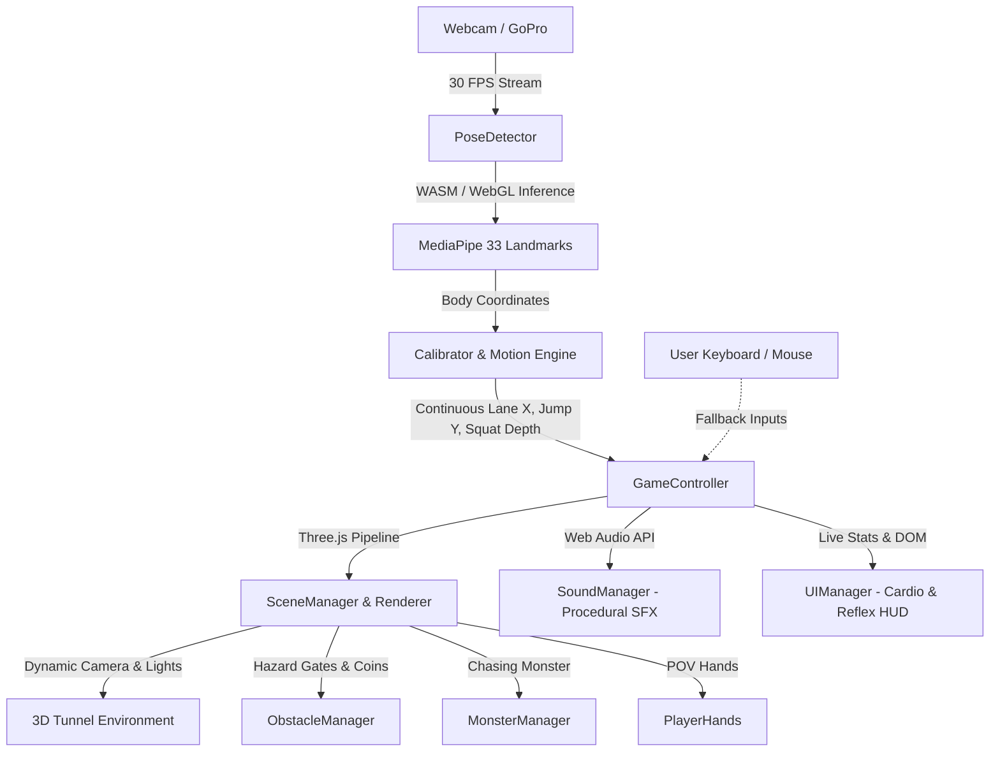

# ⚡ REFLEX RUN 3D

<div align="center">


[](https://threejs.org/)
[](https://ai.google.dev/edge/mediapipe/solutions/vision/pose_landmarker)
[](https://vitejs.dev/)
[](https://developer.mozilla.org/en-US/docs/Web/API/Web_Audio_API)
[](LICENSE)

<br/>

**A full-body motion-controlled 3D reflex runner & cardio workout powered by browser-based Computer Vision.**  
*Turn your webcam into a full-body fitness gaming arena with zero external sensors, controllers, or VR headsets.*

[Live Demo](#-quick-start) • [Features](#-key-features) • [How It Works](#-architecture) • [Controls](#-controls--mechanics) • [Setup](#-installation--development)

</div>

---

## 📖 Overview

Inspired by viral reflex training workouts (such as **Reflex Run** by `@reflexrun` & `@lieutenant_icc`), **REFLEX RUN 3D** brings first-person reflex challenges straight into your web browser. 

The game observes your body in real time via a laptop webcam or GoPro, tracks 33 full-body landmarks with **Google MediaPipe Pose**, and projects you into a high-speed 3D tunnel where you must physically:
- ⬅️ **Dodge Left** & ➡️ **Dodge Right** across 3 lanes
- ⬆️ **Leap & Jump** over ground hurdles, spike pits, and flame hazards
- ⬇️ **Duck & Squat** low under sweeping steel beams and axes
- 🥊 **Punch & Strike** floating golden idol targets with your hands
- 👹 **Outrun the Pursuing Shadow Beast** stalking right on your heels

---

## ✨ Key Features

### 🎯 1. Zero-Hardware Pose Estimation
- **Client-Side AI**: Powered by `@mediapipe/tasks-vision` PoseLandmarker via WebAssembly & WebGL.
- **Asynchronous CV Loop**: Computer vision inference is decoupled from the 60 FPS Three.js render loop to ensure zero dropped frames or stuttering.
- **Multi-Point Torso & Head Tracking**: Works whether the camera frames full body or knees-up by dynamically blending shoulder, hip, and head landmarks.

### 🏃 2. Immersive First-Person 3D Experience (Three.js)
- **Dynamic Camera Physics**: The camera physically banks, ducks, and bounds along with your real-world body displacement.
- **First-Person Animated Hands**: High-energy first-person athletic gloves that pump while running, brace during slides, and punch targets.
- **Pursuing Shadow Beast**: An ancient temple beast that recedes into the fog on high streaks and lunges forward whenever you stumble.

### 📊 3. Tactical Cardio & Reaction Tracking
- **Millisecond Reaction Speed**: Measures your exact physical response latency for every obstacle (e.g. `⚡ 180ms • PERFECT!`).
- **Live Metabolic Burn**: Real-time calorie computation based on physical jump work, squats, lateral leaps, and continuous running cadence.
- **Heart Rate & Intensity Zones**: Simulates aerobic workout zones scaling up from 120 BPM to 190 BPM.

### 🔊 4. Procedural Web Audio Sound Engine
- **Ascending Pentatonic Coin Streaks**: Coins chime in an ascending scale ($C_6 \to D_6 \to E_6 \to G_6 \to A_6 \to C_7$).
- **Tribal Percussion & Footstep Cadence**: Polyrhythmic djembe drums that accelerate as the challenge level scales up.
- **Visceral SFX**: Athletic jump launch sounds, grinding stone slide friction, and beast growls.

### ⚙️ 5. Smart Guided Calibration
- 7-step interactive calibration flow with real-time motion gauges and camera framing indicators.
- Instant skip option (<kbd>Enter</kbd> or <kbd>Space</kbd>) for quick drop-in sessions.

---

## 🕹️ Controls & Mechanics

| Physical Action | In-Game Response | Keyboard Fallback |
| :--- | :--- | :---: |
| **Step / Lean Left** | Steers camera & hands into Left Lane | <kbd>←</kbd> or <kbd>A</kbd> |
| **Step / Lean Right** | Steers camera & hands into Right Lane | <kbd>→</kbd> or <kbd>D</kbd> |
| **Physical Jump** | Vaults over ground barriers & fire traps | <kbd>↑</kbd> or <kbd>W</kbd> |
| **Squat / Crouch Low** | Ducks under sweeping overhead beams | <kbd>↓</kbd> or <kbd>S</kbd> |
| **Punch / Arm Raise** | Strikes floating golden targets | Left/Right Click |
| **Toggle Camera View** | Switch between First-Person POV and 3rd-Person Avatar | <kbd>V</kbd> |
| **Camera Overlay** | Toggle live skeleton / webcam preview | <kbd>C</kbd> |
| **Pause / Resume** | Pauses workout session | <kbd>P</kbd> or <kbd>Esc</kbd> |
| **Mute Audio** | Mutes sound effects and beat | <kbd>M</kbd> |
| **Fullscreen** | Toggles fullscreen mode | <kbd>F</kbd> |

---

## 🏗️ Architecture



---

## 📁 Repository Structure

```
reflex-run/
├── index.html                   # HTML5 Entry Point & Overlay HUD
├── package.json                 # Dependencies & Scripts
├── vite.config.js               # Vite bundler configuration
├── public/                      # Static assets & icons
└── src/
    ├── main.js                  # Application bootstrapper
    ├── style.css                # Arcade glassmorphism styling
    ├── audio/
    │   └── SoundManager.js      # Web Audio procedural sound synthesizer
    ├── cv/
    │   ├── Calibrator.js        # Step-by-step calibration engine
    │   ├── PerformanceMonitor.js# Latency & FPS telemetry
    │   └── PoseDetector.js      # MediaPipe Pose Landmarker wrapper
    ├── game/
    │   ├── Environment.js       # Infinite 3D tunnel, materials & lighting
    │   ├── GameController.js    # Core workout game loop & mechanics
    │   ├── MonsterManager.js    # Chasing demon beast logic & animations
    │   ├── ObstacleManager.js   # Procedural hazard gates & coin trails
    │   ├── PlayerHands.js       # First-person animated gloves
    │   └── SceneManager.js      # Three.js scene, camera & render setup
    └── ui/
        └── UIManager.js         # HUD, workout dashboard & score screens
```

---

## 🚀 Installation & Development

### Prerequisites
- [Node.js](https://nodejs.org/) (v18.0 or later recommended)
- A working webcam, built-in laptop camera, or GoPro connected in USB webcam mode.

### 1. Clone the repository
```bash
git clone https://github.com/zaidan-contractor/REFLEX-RUN.git
cd REFLEX-RUN
```

### 2. Install dependencies
```bash
npm install
```

### 3. Run development server
```bash
npm run dev
```
Open **`http://localhost:5173/`** in your browser (Google Chrome or Microsoft Edge recommended for best WebAssembly/WebGL performance).

### 4. Build for production
```bash
npm run build
```

---

## 💡 Tips for the Best Experience

1. **Camera Placement**: Position your camera approximately at waist or chest height, 4–8 feet away.
2. **Lighting**: Ensure your front is well lit so the computer vision model can accurately pick out joint landmarks.
3. **Space**: Have roughly 4–6 feet of lateral clear space to step left and right comfortably.
4. **Clothing**: High contrast clothing relative to your room background improves pose tracking confidence.

---

## 📜 License

Distributed under the **MIT License**. See `LICENSE` for more information.

<div align="center">
  <sub>Built with ❤️ for fitness enthusiasts, tactical athletes, and gamers.</sub>
</div>
